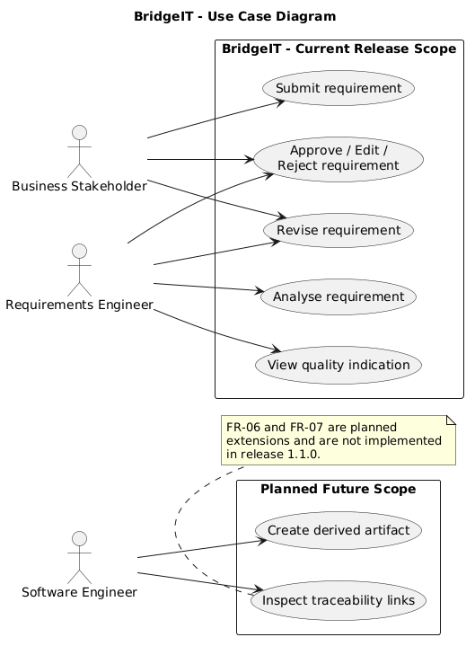

# Requirements

## User stories

- As a Business Stakeholder, I want to submit a requirement in natural language, so that my intent is captured as a structured artifact I can later review.
- As a Requirements Engineer, I want the platform to analyze a requirement for ambiguity or incompleteness, so that I can identify issues before the requirement is validated.
- As a Business Stakeholder or Requirements Engineer, I want to revise a requirement's wording after an analysis has surfaced an issue, so that the requirement can be improved before validation.
- As a Requirements Engineer, I want to see a quality indication for a requirement, so that I can decide whether it needs further clarification.
- As a Business Stakeholder or Requirements Engineer, I want to explicitly approve, edit, or reject a requirement after reviewing the AI analysis, so that no interpretation of my requirement becomes authoritative without my consent.

### Planned future user stories

The following user stories describe planned extensions and are **not part of the implemented scope of release 1.1.0**:

- As a Software Engineer, I want to inspect which artifacts are linked to a given requirement, so that I understand the origin of what I am implementing.
- As a Software Engineer, I want to create a derived artifact from a validated requirement, so that I can begin implementation work with a clear, traceable link back to its source.

PlantUML source: [`bridgeit-use-case-diagram.puml`](../../diagrams/plantuml/bridgeit-use-case-diagram.puml).

The diagram documents both the implemented core workflow and the planned extension points described above.

## Requirements analysis

### Functional — current release scope

- FR-01: the user must be able to submit a requirement expressed in natural language, having it stored as a structured, persistent artifact with a unique identifier
- FR-02: the system must use the AI Gateway to analyze a submitted requirement's text and identify potential quality issues (ambiguity, incompleteness)
- FR-03: the user must be able to revise a requirement's wording after an analysis has surfaced an issue, keeping the same identifier across the revision
- FR-04: the system must produce a quality indication for a requirement, distinguishing at least "ready for validation" from "needs clarification"
- FR-05: the user must explicitly approve, edit, or reject the requirement after reviewing the AI analysis, before the human decision can affect the requirement's authoritative state

### Planned future functional requirements

The following requirements are retained as documented extension goals, but are **not part of the Definition of Done for release 1.1.0**:

- FR-06: the user must be able to create and inspect traceability links between a requirement and the artifacts derived from it
- FR-07: the user must be able to create a derived, structured artifact from a validated requirement, preserving its link to the source requirement

They are discussed further in [Future work](../12-future/).

### Non-functional — current release scope

- NF-01: changes to one concern (e.g. persistence, AI provider) must not require changes to unrelated parts of the system
- NF-02: domain and application logic must be verifiable through automated tests independently of external infrastructure
- NF-03: the system must be composed of clearly bounded modules with explicit responsibilities, consistent with DDD and Hexagonal Architecture
- NF-04: AI capability must be accessed through an abstraction (the AI Gateway) allowing the provider to be replaced without affecting domain or application logic
- NF-05: AI provider credentials must never be embedded in source code or version control
- NF-06: new requirement-derived artifact types or AI-assisted capabilities must be introducible without restructuring existing modules
- NF-07: failures in an external dependency (e.g. AI provider unavailability) must not corrupt or lose previously stored requirement data
- NF-08: failures in external dependencies must surface a clear, actionable indication rather than an unhandled failure
- NF-09: environment-specific settings (e.g. AI provider credentials) must be externalized from the codebase

### Planned future non-functional requirement

- NF-10: significant domain events should be logged to support debugging, without logging sensitive content in plaintext

NF-10 is a documented future improvement and is not part of the release 1.1.0 Definition of Done.

### Implementation

- I1: the system must use SQLite as its DBMS, mandated by the course once the team grew to two members
- I2: the system must provide a web or desktop frontend, mandated by the course for the same reason

All other technical choices (`sqlite3` over an ORM, vanilla HTML/CSS/JavaScript over a frontend framework, FastAPI, Gemini as the AI provider, etc.) are design decisions made to satisfy the requirements above, not externally imposed constraints, they are discussed and justified in the Design section instead.

## Glossary

- **Requirement**: a single unit of business or system intent, originally expressed in natural language, tracked through its lifecycle from submission to validation
- **AI Analysis**: the outcome of an AI-assisted evaluation of a requirement's text, including a quality indication and, where applicable, a list of identified issues — always a proposal, never an automatic change
- **Derived Artifact**: a structured, engineering-facing object (e.g. a backlog item) created from a validated requirement, retaining an explicit reference back to it
- **Traceability Link**: an explicit, inspectable relationship connecting a requirement to a derived artifact or another object derived from it
- **Quality Indication**: a non-binding assessment of a requirement's clarity, completeness, and freedom from ambiguity, intended to guide — not replace — human judgment
- **Validation**: the explicit human decision (approve, edit, or reject) required before an AI suggestion can affect a requirement's authoritative state

## Acceptance Criteria and Definition of Done

The following criteria define when each requirement in the **current release scope** is considered done. Evidence for these criteria is documented in the [Validation](../05-validation/) chapter.

| Requirement | Definition of Done |
|---|---|
| **FR-01** | A non-empty requirement can be submitted, receives a unique identifier and `Submitted` status, is persisted, and can later be retrieved with the same text. |
| **FR-02** | An eligible requirement can be analysed through the `AIGateway`; an `AIAnalysis` is returned, the authoritative text is not autonomously changed, and the requirement moves to `Analyzed`. |
| **FR-03** | An analysed requirement can be edited while preserving its identifier; the revised text is persisted and the requirement moves to `Clarified`. |
| **FR-04** | AI analysis returns either `ready_for_validation` or `needs_clarification`; this indication does not itself constitute a final human decision. |
| **FR-05** | A human can explicitly approve, edit, or reject an analysed requirement; the corresponding lifecycle state is persisted and retrievable. |
| **NF-01** | Persistence and AI-provider concerns remain behind ports, so infrastructure implementations can change without modifying the domain model. |
| **NF-02** | Domain and application behavior is covered by automated tests that can run with fakes/mocks and without external infrastructure. |
| **NF-03** | Source modules have explicit domain, application, adapter, and infrastructure responsibilities consistent with the documented Hexagonal Architecture. |
| **NF-04** | AI-provider access occurs through `AIGateway`; provider-specific Gemini code remains confined to the infrastructure adapter. |
| **NF-05** | `GEMINI_API_KEY` is supplied through the environment and is not embedded in the source code or committed configuration. |
| **NF-06** | Extension points are represented by explicit ports and modular boundaries so additional adapters or capabilities can be added without restructuring the existing core. |
| **NF-07** | AI-provider failures do not overwrite or corrupt a previously persisted requirement; failure behavior is exercised by automated tests. |
| **NF-08** | External dependency failures are translated into controlled application/API errors instead of unhandled failures. |
| **NF-09** | Environment-specific configuration, including the Gemini credential, is externalized from application source code. |
| **I1** | The SQLite persistence adapter successfully stores and retrieves requirements using a real SQLite database in integration tests. |
| **I2** | The browser frontend can execute the implemented Requirement → AI Analysis → Human Validation workflow against the running API. |

### Future-scope intended acceptance criteria

These criteria document the intended behavior of the planned extensions but are **not acceptance criteria for release 1.1.0**:

- **FR-06:** a traceability link between a requirement and a derived artifact should be retrievable from either side of the relationship.
- **FR-07:** an artifact created from a `Validated` requirement should retain an explicit reference to its source; creation should be refused for requirements that are not validated.
- **NF-10:** significant domain events should be recorded without logging sensitive requirement content in plaintext.
